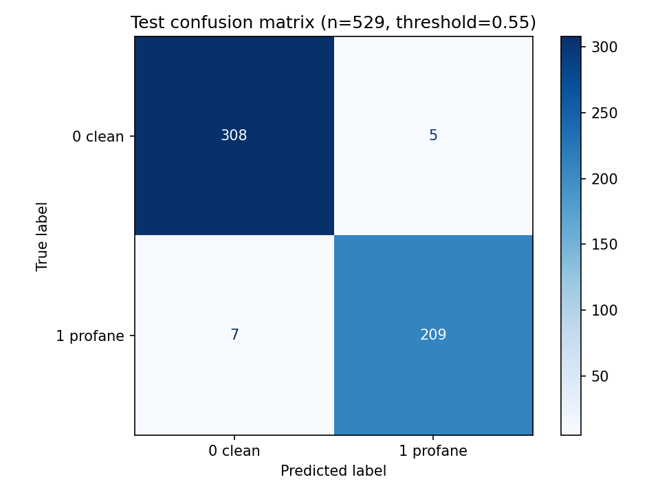

# Kazakh Profanity Detection

DSSC5113 Algorithms of Computer Vision — Bonus Project (KBTU, Fall 2026)
**Author:** Zhanabil Alikhan · **Student ID:** 25MD0222

## 1. Task
Input: one Kazakh product review or comment. Output: **0 = no Kazakh profanity**, **1 = Kazakh profanity present**, together with the model probability P(profanity).

## 2. Repository structure
```
Kazakh_Profanity_Detection.ipynb   # full pipeline: data -> training -> evaluation -> prediction
src/textprep.py                    # text cleaning / normalization (used by the model)
src/lexicon.py                     # profanity patterns used to find and pre-label candidates
src/predict.py                     # command-line prediction with the saved model
data/labeled.csv                   # final labeled dataset
data/to_review.csv                 # real reviews for manual labeling
data/splits/train.csv val.csv test.csv
models/profanity_model.joblib      # trained model (TF-IDF + Logistic Regression pipeline)
models/config.json                 # settings, threshold, seed, versions
results/                           # metrics.json, confusion_matrix.png, test_predictions.csv, errors.csv, sample_predictions.csv
requirements.txt
```

## 3. Dataset
**Source:** KazSAnDRA — Kazakh Sentiment Analysis Dataset of Reviews and Attitudes (ISSAI, Nazarbayev University), CC BY 4.0.
https://huggingface.co/datasets/issai/kazsandra — downloaded automatically in Step 1 of the notebook (`data/all_reviews.csv`, not stored on GitHub because of size).

**Relation to the task:** real Kazakh user reviews of apps, products, books and places, including mixed Kazakh–Russian text, Latin script and slang — the kind of text a marketplace needs to moderate. Its sentiment labels do **not** match this task (negative ≠ profane), so they were not used; new profanity labels were created.

**Labeling method:**
1. Random sample of 2,000 reviews (seed 42) + all reviews where the profanity lexicon (`src/lexicon.py`) found a candidate.
2. Lexicon gives a first label; labels checked by hand in `data/to_review.csv` → `data/manual_labels.csv`. Manually labeled rows in this run: **0**. Rows without a manual check keep the lexicon label (`label_source = lexicon_auto`).
3. **Synthetic examples** (`is_synthetic = 1`, `label_source = synthetic_template`): template comments written by the author, with matching clean negative templates (same sentence, no profanity) and substring traps (*көтеру*, *амал*, *бокс*).

**Size:** 3682 samples — 3151 real, 531 synthetic. Class distribution: label 0 = 2187, label 1 = 1495.

| | label 0 | label 1 |
|---|---|---|
| real | 1982 | 1169 |
| synthetic | 205 | 326 |

Personal information (URLs, e-mails, phone numbers, @usernames) is removed; no reviewer names are stored.

### Labeling rules
- **1** — obscene/vulgar Kazakh words (sexual, genital, excretory: e.g. *боқ*, *қотақ*, *сік-*, *жезөкше*, *көтіңе*) and fixed curse formulas (*әкеңнің аузын…*, *иттің баласы*).
- **1** — masked or misspelled forms with clear meaning (*с\*к*, *б\*\*қ*, *бооооқ*, Latin *qotaq*).
- **1** — Kazakh profanity inside a mixed Kazakh–Russian comment.
- **0** — negative or angry reviews without profanity (*Сапасы өте нашар, ақшамды қайтарыңыз*).
- **0** — mild, non-obscene insults (*ақымақ*, *топас*, *оңбаған*).
- **0** — words that only contain a profane-looking substring (*көтеру*, *амал*, *бокс*).
- **0** — profanity only in Russian (out of scope: the task is *Kazakh* profanity) — listed as a limitation.
- Ambiguous cases → 0, with a comment in the `note` column.

### Labeled examples
| text | label | is_synthetic | label_source |
|---|---|---|---|
| Кермет маған қатты ұнады. Күшті праграма!!!!! | 0 | 0 | lexicon_auto |
| Ужас ой мамаааа | 0 | 0 | lexicon_auto |
| Керемет мен окып журмын сурелерды | 0 | 0 | lexicon_auto |
| Котак екен | 1 | 0 | lexicon_auto |
| Шаршатты барғо мына боқтық регистрация жасалмай, то кірмейді, то лақтырып тастайды! Өте нашар! Говно | 1 | 0 | lexicon_auto |
| Сағат керемет, бәріне ұсынамын | 0 | 1 | synthetic_template |
| Наушник нағыз б*қ, ақшамды босқа төледім | 1 | 1 | synthetic_template |
| Ақшамды қайтарыңдар, sikteyin osy magazindi | 1 | 1 | synthetic_template |

### Splits
Grouped split (near-duplicates in the same split): real reviews are grouped by their letters-only normalized text; synthetic examples by their (template, word) family. 70/15/15, stratified, **seed = 42**. Exact duplicates removed.

| split | total | label 0 | label 1 | synthetic |
|---|---|---|---|---|
| train | 2620 | 1553 | 1067 | 427 |
| val | 533 | 321 | 212 | 54 |
| test | 529 | 313 | 216 | 50 |

## 4. Model
**TF-IDF character n-grams (`char_wb`, n-gram range (1, 4)) + Logistic Regression (C = 32.0, class_weight = balanced)**, scikit-learn.

- *Why:* profanity appears in many spellings (Cyrillic/Latin, masked, stretched, Russian letters instead of Kazakh). Character n-grams share features between spelling variants; the model is small, fast, and interpretable (largest-weight n-grams can be printed).
- *Text → input:* raw text → `normalize()` (lowercase, ё→е, digits→0, mask symbols→`*`, repeated letters collapsed, punctuation removed, max 2,000 chars) → character n-grams → TF-IDF vector (vocabulary and IDF fitted on **train only**) → logistic regression → P(profanity) → label 1 if P ≥ threshold.
- *Long comments:* cut to 2,000 characters; sublinear TF + L2 normalization keep long and short texts comparable.
- *Punctuation:* removed, except `*` which marks masking.
- *Unknown words:* split into character n-grams; n-grams never seen in training are ignored, so the model never fails on new words.
- *Objective:* class-weighted binary cross-entropy (log-loss) with L2 regularization.
- *Selection:* grid over n-gram range {(1,4),(2,5),(3,6)} × C {0.5, 2, 8, 32} by validation F1; decision **threshold = 0.554** chosen to maximize validation F1 (`results/hyperparameter_search.csv`).

## 5. Setup and usage
```bash
git clone <this repo>
cd <repo>
pip install -r requirements.txt
```
**Train from scratch (reproducible):** open `Kazakh_Profanity_Detection.ipynb` (locally or in Google Colab) → *Run all*. Seed = 42.

**Predict without retraining:**
```bash
python src/predict.py "Мынау не боқ, екі күнде сынды"
```
or in Python:
```python
import sys; sys.path.insert(0, "src")
from predict import predict
print(predict("Тауар сапалы, рахмет!"))
```
The trained model (`models/profanity_model.joblib`) and its preprocessing (`src/textprep.py`, `models/config.json`) are in this repository.

## 6. Results (test set, evaluated once)
Test examples: **529** (216 profane). Threshold 0.554.

| Metric (profanity class) | Value |
|---|---|
| Precision | 0.977 |
| Recall | 0.968 |
| F1 | 0.972 |

Real reviews only (n=479): precision 0.972, recall 0.961, F1 0.966.

Confusion matrix (rows = true, columns = predicted): TN = 308, FP = 5, FN = 7, TP = 209



- **False positive:** a clean review is flagged → an honest (often negative but useful) review gets hidden.
- **False negative:** a profane review is missed → offensive text is published.
- For moderation, false negatives are usually worse; flagged reviews should go to a human moderator, and the threshold can be lowered to increase recall.

### Errors and challenging examples
Test errors (first 5, full list in `results/errors.csv`):

| text | label | pred | prob_profane | error |
|---|---|---|---|---|
| Шешеңнің амы, қотағыма өшіп қала береді, мал ойын сука! | 0 | 1 | 0.996 | FP |
| Маған еөшірімейдіғо қ*ақбас | 0 | 1 | 0.782 | FP |
| Сігілш | 0 | 1 | 0.696 | FP |
| Зайбал кизык емас коттаринга тикинлар дослар | 0 | 1 | 0.596 | FP |
| Тартпасамда топқо. (Если чё бұл менің басқа акк мен бірлетте отвыз тастағам 5 еу но баяғыда ABDIRAHM | 0 | 1 | 0.58 | FP |

Hand-written challenging examples (`results/sample_predictions.csv`):

| text | expected | pred | prob_profane | case |
|---|---|---|---|---|
| Телефон керемет, бәріне ұсынамын! | 0 | 0 | 0.017 | clean positive review |
| Сапасы өте нашар, ақшамды қайтарыңдар!!! | 0 | 0 | 0.005 | angry but clean |
| Ауыр екен, көтеру қиын | 0 | 0 | 0.006 | substring trap: көтеру |
| Амалсыз қайтардым, өлшемі келмеді | 0 | 0 | 0.005 | substring trap: амал |
| Сатушы ақымақ, тауар басқа | 0 | 0 | 0.453 | mild insult (rule: 0) |
| Мынау не боқ, екі күнде сынды | 1 | 1 | 0.995 | plain profanity |
| б.о.қ телефон | 1 | 0 | 0.141 | letters separated by dots |
| б о қ телефон | 1 | 0 | 0.141 | letters separated by spaces |
| q0taq tauar | 1 | 0 | 0.523 | Latin + digit instead of o |
| Курьер иттің баласы екен | 1 | 1 | 0.983 | curse formula |
| Боктай сапа | 1 | 1 | 0.64 | Russian 'к' instead of 'қ' |

✍️ **Discussion (edit after looking at the tables):**
1. *Spaced/dotted letters* (`б о қ`): `char_wb` builds n-grams inside words, so the profane word is split into single letters. Fix: join single letters before vectorizing.
2. *Look-alike characters* (`q0taq`): digits are mapped to `0`, so the variant does not match `qotaq`. Fix: map look-alikes (0→o, Latin→Cyrillic) in `normalize` or add variants to training data.
3. *Substring traps and mild insults* (`көтеру`, `ақымақ`): share n-grams with profane words. Fix: more real hard negatives and manual review of borderline cases.

## 7. Limitations
- Real profane reviews are rare; many positives are synthetic, which are easier than real comments (compare overall vs real-only metrics).
- Real labels not checked by hand come from the lexicon, so the model partly learns the lexicon and test scores can be optimistic on lexicon-like words.
- Russian-only profanity is labeled 0 by design; the model is not a general toxicity detector.
- Small lexicon; regional slang and new spellings may be missed.

## 8. Acknowledgments
Dataset: KazSAnDRA (Yeshpanov & Varol, LREC-COLING 2024), CC BY 4.0.
AI assistance: Claude (Anthropic) helped draft the notebook code and README. ✍️ My own contributions: (fill in — e.g. labeling rules, manual labeling, lexicon review, error analysis, experiments).
